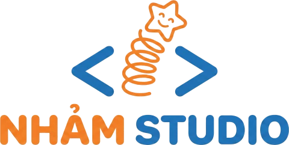

# dLext-Browser
dLext Browser - trình duyệt nhẹ trên nền Edge

Phát triển bởi **NhảmStudio** · [topvl.net](https://topvl.net)

Trình duyệt tích hợp dLext:

1. **dLext cho Edge** (*khuyên dùng làm trình duyệt hằng ngày*): `dLext.exe` ~190 KB chạy trên lõi Microsoft Edge có sẵn trong Windows, với hồ sơ riêng và tiện ích dLext tích hợp. **Đăng nhập Google được**, tự cập nhật bảo mật theo Edge.

Giao diện tiếng Việt / tiếng Anh, có chế độ sáng / tối.

## Tính năng chung

| | Cách hoạt động |
|---|---|
| **Danh sách media** | Video/nhạc trực tiếp (mp4, webm, mp3, m4a…), luồng **HLS** (`.m3u8`), **DASH** (`.mpd`), phụ đề. Phát hiện qua lưu lượng mạng của **mọi khung (iframe)** trong tab, cộng với quét thẻ `<video>/<audio>` và liên kết trên trang. Media đến từ trình phát nhúng của trang khác được ghi rõ “từ &lt;tên trang&gt;”. |
| **Chọn chất lượng** | HLS: độ phân giải, bitrate, codec, track âm thanh. DASH: chất lượng video, track âm thanh, hoặc chỉ âm thanh. Có ước tính dung lượng. Hỗ trợ fMP4, byte-range, mã hóa AES-128. |
| **Ghép video + âm thanh** | Khi luồng có âm thanh tách riêng (DASH, HLS fMP4), dLext **ghép thành 1 tệp MP4** ngay khi tải, không nén lại, có chỉ mục để tua. Nếu không ghép được (ví dụ WebM), dLext giữ 2 tệp. |
| **Luồng trực tiếp** | Ghi luồng HLS live, bấm **Dừng & lưu** bất kỳ lúc nào. |
| **Trình phát nhúng** | Liệt kê YouTube, Vimeo, Dailymotion, Facebook, SoundCloud, TikTok, Twitch, Zing MP3, NhacCuaTui… kèm nút mở trang gốc / sao chép liên kết. Mở và bấm phát để dLext bắt luồng. |
| **Ảnh: bấm để tải** | Ảnh **không còn bị liệt kê** trong danh sách. Khi cần, **bấm vào ảnh** trên trang: một nút tải nhỏ hiện ở góc ảnh (nút ▾ để chọn kích thước/phiên bản khác: ảnh gốc qua liên kết, các ứng viên `srcset`/`<picture>`). Nút này dùng được cả khi trang **chặn chuột phải** hoặc **phủ lớp trong suốt** lên ảnh, và với ảnh nền CSS. **Alt + bấm** để không mở liên kết của ảnh. Nút tự ẩn sau vài giây hoặc khi cuộn trang. |
| **Tua nhanh** | 1× … 16× theo tốc độ gốc của trình duyệt. 16× – 20× là 16× kết hợp nhảy trong vùng đã tải, nên luồng không bị đứng. Áp dụng cho mọi video/nhạc của trang, kể cả trong iframe, và cho cả video tải sau. |

Không tải được nội dung có DRM (dLext hiện nhãn DRM). Xem thêm phần [Giới hạn](#giới-hạn).

---

## Tính năng

Trình duyệt hằng ngày đăng nhập được Google mà vẫn gọn: `dLext.exe` (~190 KB) mở **Microsoft Edge** (có sẵn trong Windows 10/11, không gỡ được) với **hồ sơ riêng của dLext** và **tiện ích dLext nạp sẵn**. Edge là trình duyệt đầy đủ nên Gmail, YouTube, Gemini, “Đăng nhập bằng Google” trên các trang khác đều dùng bình thường; Edge tự cập nhật bảo mật.

### Cài

1. Tạo bộ cài: tải bộ cài: dLext-Edge-Setup-1.3.0.exe` (187 KB) từ [*Release*](Release).
2. Chạy `dLext-Edge-Setup-1.3.0.exe`: cài vào `%LOCALAPPDATA%\Programs\dLext` (không cần quyền quản trị), tạo shortcut **dLext** trên Desktop và Start menu, thêm **dLext (Ẩn danh)**, có mục gỡ cài đặt trong *Settings → Apps*.
3. Muốn mọi liên kết mở bằng dLext: *Settings → Apps → Default apps → Web browser → dLext*.

nằm trong `dLext\data`.

### Có gì

- **dLext tích hợp**: danh sách media (kể cả trình phát nhúng), tải HLS/DASH, ghép MP4, nút tải ảnh, tốc độ tới 20×.
- **Nút dLext ghim sẵn** cạnh ô địa chỉ (Edge thường giấu tiện ích trong menu ghép hình). Bấm vào mở **bảng cạnh bên** tự đổi theo tab đang xem.
- **Tua nhanh ngay trên video**: rê chuột vào video, góc trên bên trái hiện **− 1× +**; bấm vào số để chọn nhanh 0,5× … 20×. Phím **Alt+↑ / Alt+↓ / Alt+0**.
- **Màu dLext** (tím) cho thanh tab và thanh công cụ, cửa sổ ẩn danh màu tối; hồ sơ tên **dLext**.
- Gửi `Referer` như trang tự gửi khi tải luồng, nên tải được từ CDN đòi `Referer`.
- **Trang tab mới gọn của dLext** (ô tìm kiếm Google / Bing / DuckDuckGo / Cốc Cốc) thay cho trang tin tức MSN nặng của Edge.
- Hồ sơ riêng, giao diện tiếng Việt, tải về thư mục Tải xuống không hỏi (tệp vào `dLext\<trang>`).
- **Không chạy nền**: đóng cửa sổ cuối cùng là Edge thoát hẳn (đo: 0 tiến trình còn lại). Các tab cùng trang dùng chung một tiến trình.
- Chặn quảng cáo: AdGuard cho Windows lọc Edge sẵn. Không dùng AdGuard thì cài **uBlock Origin Lite** từ cửa hàng tiện ích Edge.

### Lưu ý

- Đây là Edge thật nên **một số thứ vẫn của Edge**: biểu tượng của cửa sổ trên thanh tác vụ, chữ “Microsoft Edge” cuối tiêu đề cửa sổ, menu ⋯ và trang `edge://settings`. Windows không cho chương trình khác đổi biểu tượng cửa sổ của Edge (đã thử). Shortcut, mục trong Start menu, danh sách ứng dụng và Default apps là của dLext. Muốn một trình duyệt mang giao diện, biểu tượng riêng hoàn toàn thì phải là trình duyệt nhúng (như bản Electron ở dưới), và Google sẽ chặn đăng nhập.
- Edge có thể nhắc về “tiện ích ở chế độ nhà phát triển”: dLext nạp tiện ích từ thư mục cài, không qua cửa hàng. Bấm đóng thông báo là được.
- Muốn dLext chạy cả trong cửa sổ ẩn danh: `edge://extensions` → dLext → *Chi tiết* → bật **Cho phép trong InPrivate** (làm một lần).
- Đổi thư mục tải (ổ bất kỳ): `edge://settings/downloads` → *Vị trí*.
- **Ẩn Copilot, thanh bên, mua sắm của Edge**: bấm đúp `edge/policies/an-copilot-thanh-ben-mua-sam.reg`, đồng ý UAC (cần quyền quản trị vì đây là chính sách Edge cho cả máy), rồi đóng và mở lại dLext. Kiểm tra ở `edge://policy`. Edge sẽ ghi “do tổ chức quản lý”. Muốn bật lại: `bat-lai-copilot-thanh-ben.reg`. Bảng cạnh bên của dLext vẫn mở được khi thanh bên của Edge bị tắt (đã thử với Edge 156); nếu một bản Edge sau này chặn nó, nút dLext tự mở dạng **popup**.
- Dữ liệu duyệt web nằm ở `%LOCALAPPDATA%\dLext\Edge`. Gỡ cài đặt sẽ hỏi có xóa dữ liệu này không.

## Giới hạn

- **YouTube**: YouTube phát video qua giao thức được bảo vệ (SABR/UMP, PO token, mã hóa chữ ký). Lấy được video sẽ phải giả danh ứng dụng YouTube khác để vượt kiểm tra bot, nên dLext **không làm việc đó**. Trên YouTube, dLext hiện thông báo; tốc độ phát (tới 20×) vẫn dùng được. Ở trình duyệt dLext, nếu bạn tự cài và khai báo một công cụ tải ngoài thì có thể giao trang cho công cụ đó.
- **DRM** (Widevine/PlayReady/FairPlay, HLS `SAMPLE-AES`, DASH `ContentProtection`): không tải được. Trình duyệt dLext (Electron) cũng **không phát** được nội dung Widevine như Netflix, Spotify, Disney+.
- Tốc độ trên 16× là tua nhảy nên hình sẽ giật. Chromium tắt tiếng khi phát nhanh hơn ~4×.
- HLS dạng MPEG-TS được lưu thành `.ts` (VLC, MPV, Windows Media Player phát được). Đổi sang MP4 nếu cần: `ffmpeg -i "video.ts" -c copy "video.mp4"`.
- Âm thanh/video tách riêng dạng WebM hoặc TS chưa được ghép (lưu 2 tệp). Ghép bằng `ffmpeg -i video -i audio -c copy out.mkv`.
- Chưa hỗ trợ ghi luồng **DASH trực tiếp**.
- **Đăng nhập Google** (Gmail, Gemini, YouTube, “Đăng nhập bằng Google” trên X…): Google chặn đăng nhập từ trình duyệt dựng trên Electron và báo *“Couldn't sign you in – This browser or app may not be secure”*. Đây là kiểm tra bảo mật có chủ đích của Google, dLext không tìm cách vượt qua. Với các trang này, hãy dùng cách đăng nhập khác của trang (ví dụ email và mật khẩu của X), hoặc dùng Chrome/Edge.
- Một số CDN chặn tải nếu thiếu `Referer`/token. dLext gửi kèm `Referer` đúng như trang tự gửi (toàn bộ địa chỉ cho cùng trang, chỉ tên miền cho CDN khác). Tiện ích làm việc này cho luồng HLS/DASH trong Chrome/Edge; tệp tải thẳng thì không.
---

dLext © NhảmStudio · [topvl.net](https://topvl.net)
